# KAIROS-TWIN Complete Report Evidence Document

This single document consolidates the evidence package for sharing with ChatGPT or another report-writing assistant. It contains the verified project overview, architecture, dataset, feature engineering, ML results, validation, API, frontend, testing, limitations, screenshot guide, and final structured facts.

Source folder: `REPORT_EVIDENCE/`.

---

<!-- Source: REPORT_EVIDENCE/PROJECT_OVERVIEW.md -->

# Project Overview

## Project Title

KAIROS-TWIN: Student Digital Twin for Academic Overload Risk, What-If Simulation, and Intervention Tracking.

## Objective

The project estimates short-term academic overload risk for a student from longitudinal observations, represents the student's current condition as a digital twin, explores hypothetical interventions, and logs follow-up outcomes. The implementation connects a synthetic longitudinal dataset, a temporal label definition, a 46-feature production contract, a frozen production ML model, a FastAPI backend, and a React frontend.

## Problem Statement

Academic overload is not represented by one signal alone. The project models overload as a future 7-day outcome using missed deadlines, grade deterioration, study collapse, recovery failure, and high stress. The system must predict risk from observations available at or before the current day, explain state factors, test simulated scenario changes, and support intervention follow-up without leaking future outcomes into features.

## Motivation

Students and faculty need earlier, interpretable warnings about workload and recovery pressure. The system is designed to show risk estimates, the underlying twin state, counterfactual scenario projections, and follow-up tracking in one workflow instead of producing only an isolated classifier output.

## Novelty And Contribution

- A digital twin representation, `StudentTwinState`, built from historical observations through `core/twin_engine.py`.
- A temporally valid label engine in `core/label_engine.py` using future `[t+1, t+7]` outcomes only for labels.
- A frozen 46-feature production feature contract in `core/feature_engine.py`.
- Production serving through `simulation/prediction_service.py` with artifact feature-order validation.
- What-if simulation through `simulation/counterfactual_engine.py` and transparent ranking through `simulation/scenario_ranker.py`.
- Recommendation and intervention logging through `phase6_orchestrator.py`, `intervention/intervention_registry.py`, and `intervention/outcome_tracker.py`.
- A frontend demo workflow covering command center, twin, risk, what-if lab, recommendations, faculty view, and student history.

## Target Users

- Students reviewing current overload risk and potential routine changes.
- Faculty or advisors monitoring risk, history, and intervention outcomes.
- Project evaluators reviewing a reproducible academic prototype.

## Main Use Cases

- Compute a student's current digital twin from observations.
- Estimate overload probability using the frozen production model.
- Inspect diagnostics from specialized academic, behavioral, recovery, workload, and schedule agents.
- Generate or enter what-if scenarios.
- Compare baseline risk against counterfactual risk.
- Generate a recommendation, log the student's response, and track follow-up outcome.
- View student history charts and faculty-level intervention analytics.

## Major Capabilities

- Synthetic longitudinal data simulation: `student_simulator.py`.
- Temporal sampling: `core/temporal_sampler.py`.
- Label generation: `core/label_engine.py`.
- Twin state computation: `core/twin_engine.py`.
- Feature extraction: `core/feature_engine.py`.
- Production prediction: `simulation/prediction_service.py`.
- Scenario generation/simulation/ranking: `simulation/scenario_generator.py`, `simulation/counterfactual_engine.py`, `simulation/scenario_ranker.py`.
- Recommendation and intervention workflow: `phase6_orchestrator.py`, `intervention/*`.
- API service: `api/main.py`, `api/service.py`, `api/schemas.py`.
- Frontend UI: `frontend/src`.

## End-To-End Workflow

1. A user selects or enters a student and day in the frontend.
2. The frontend sends observations to `/states/compute`.
3. `Phase7Service` validates observations, rejects future labels, adapts safe field names/scales, and calls `TwinEngine`.
4. `TwinEngine` filters to observations where `day <= t` and computes `StudentTwinState(t)`.
5. `FeatureEngine` extracts the frozen 46-feature vector.
6. `PredictionService` loads `experiments/results/model_pipeline.pkl`, verifies feature order, applies preprocessing, and returns overload probability at threshold `0.5`.
7. Diagnostics run specialized agents over the twin state.
8. Scenario tools generate or accept user scenarios, modify a cloned twin state, recompute features, and compare baseline versus counterfactual model estimates.
9. The orchestrator ranks scenario results and produces a recommendation with caveats.
10. Interventions are logged, student responses are recorded, and accepted interventions can be followed up after 7 days.
11. History and Faculty View display observations, intervention records, outcomes, and aggregate analytics.

---

<!-- Source: REPORT_EVIDENCE/SYSTEM_ARCHITECTURE.md -->

# System Architecture

## Technology Stack

- Frontend: React 18, TypeScript, Vite, React Router, Tailwind CSS, Recharts, Framer Motion, Lucide icons. Source: `frontend/package.json`, `frontend/src`.
- Backend: FastAPI with Pydantic schemas and API-key protection. Source: `api/main.py`, `api/schemas.py`, `api/security.py`.
- ML layer: frozen scikit-learn production pipeline served by `simulation/prediction_service.py`; production artifact `experiments/results/model_pipeline.pkl`.
- Digital Twin layer: `core/twin_engine.py` and `core/schemas.py`.
- Data generation/storage: synthetic simulator in `student_simulator.py`; experiment tables under `experiments/*`; Phase 7 prototype persistence under `data/phase7`.
- Recommendation system: `phase6_orchestrator.py`, `agents/*`, `intervention/recommendation.py`.
- What-if/counterfactual system: `simulation/scenario_schema.py`, `simulation/scenario_generator.py`, `simulation/state_modifier.py`, `simulation/counterfactual_engine.py`, `simulation/scenario_ranker.py`.
- Intervention/follow-up system: `intervention/intervention_registry.py`, `intervention/outcome_tracker.py`, API methods in `api/service.py`.
- Faculty monitoring and student history: frontend pages `FacultyView.tsx` and `StudentHistory.tsx`, API endpoints `/analytics/system` and `/students/{student_id}/history`.

## Backend Modules

- `api/main.py`: FastAPI application and route declarations.
- `api/schemas.py`: strict Pydantic request/response boundary; unknown fields are rejected.
- `api/service.py`: Phase 7 service facade over frozen Phase 2-6 components.
- `api/demo_data.py`: deterministic demo histories for UI-selected synthetic students.
- `api/persistence.py`: Phase 7 registry/tracker persistence paths and lock.

## Core ML And Twin Modules

- `core/twin_engine.py`: computes `StudentTwinState(t)` from observations up to day `t`.
- `core/feature_engine.py`: extracts the 46 production features in authoritative order.
- `core/label_engine.py`: constructs the future 7-day overload label.
- `core/temporal_sampler.py`: train/validation/test temporal split logic.
- `simulation/prediction_service.py`: loads production artifact, validates feature order, predicts risk.

## Intervention And Scenario Modules

- `simulation/scenario_generator.py`: deterministic candidate scenario generation.
- `simulation/counterfactual_engine.py`: baseline prediction, cloned-state modification, counterfactual prediction, delta calculation.
- `simulation/scenario_ranker.py`: transparent weighted ranking.
- `phase6_orchestrator.py`: coordinates agents, scenarios, simulation, ranking, recommendation.
- `intervention/intervention_registry.py`: logs offered interventions and student responses.
- `intervention/outcome_tracker.py`: tracks follow-up risk and prediction error.

## Mermaid Diagram

```mermaid
flowchart LR
    Student[Student] --> Frontend[React Frontend]
    Frontend --> API[FastAPI API]
    API --> Twin[Digital Twin<br/>core/twin_engine.py]
    Twin --> Features[Feature Engineering<br/>core/feature_engine.py]
    Features --> Model[Production ML<br/>experiments/results/model_pipeline.pkl]
    Model --> Prediction[PredictionService]
    Prediction --> Diagnostics[Agent Diagnostics]
    Prediction --> WhatIf[What-If Simulation]
    WhatIf --> Recommendations[Recommendations]
    Recommendations --> Intervention[Intervention Registry]
    Intervention --> FollowUp[Outcome Follow-Up]
    FollowUp --> History[History / Faculty View]
    Diagnostics --> Recommendations
```



## Request Flow

The frontend calls `/states/compute`, `/predictions`, `/diagnostics`, `/scenarios/generate`, `/simulations/run`, `/recommendations/generate`, `/interventions/log`, `/interventions/{id}/response`, `/outcomes/{id}/followup`, `/students/{id}/history`, and `/analytics/system`. Only `/health` is public; other endpoints require the configured API key.

---

<!-- Source: REPORT_EVIDENCE/DATASET_AND_SIMULATION.md -->

# Dataset And Simulation

## Raw Synthetic Dataset

Source: `student_simulator.py`.

- Students: 200.
- Days per student: 90.
- Raw daily rows: 18,000.
- Seed: 42.
- Missing rate: 0.15 on observed measurements.
- Baseline sleep: 7.5 hours.
- Sleep sensitivity: 0.50.
- Deadline motivation: 0.35.
- Observation noise: 0.10.

## Raw Columns

`student_id`, `day`, `day_of_week`, `study_hours`, `sleep_hours`, `stress_level`, `recovery_index`, `engagement_score`, `workload_pressure`, `platform_interactions`, `attendance_rate`, `grade`, `assignment_due_today`, `exam_due_today`, `pending_assignments`, `upcoming_deadlines_7d`, `missed_deadline_observed`.

## Simulation Methodology

Each student receives latent stable traits:

- `ability`
- `conscientiousness`
- `resilience`

These traits drive baseline study behavior, stress, recovery, engagement, and prior grade. The simulator then generates daily academic events and behavioral dynamics. Assignment due dates are sampled with probability `0.13` per day; exam due dates are sampled from day 10 onward with probability `0.035` per day.

Daily dynamics include:

- workload from upcoming assignments, upcoming exams, and due-today events;
- study hours influenced by baseline study, deadline motivation, stress, and workload;
- stress influenced by workload, low study, and resilience;
- sleep influenced by stress and high study effort;
- recovery influenced by sleep adequacy and stress;
- engagement influenced by conscientiousness, stress, and recovery;
- grade as a slow-moving noisy academic outcome;
- platform interactions and attendance as observable proxies;
- missed deadline when a due assignment coincides with high stress/workload after resilience adjustment.

## Missing-Data Behavior

Missingness is applied only to observed measurements:

`study_hours`, `sleep_hours`, `stress_level`, `recovery_index`, `engagement_score`, `workload_pressure`, `platform_interactions`, `attendance_rate`, `grade`.

Identifiers, event flags, and label-support columns are not randomly blanked by the simulator.

## Temporal Structure

Source: `core/temporal_sampler.py`.

- Warm-up: days 1-14, no predictions.
- Train: days 15-55.
- Validation: days 56-69.
- Test: days 70-83.
- Outcome-only: days 84-90, used for future labels but not predictions.

Each sample has:

- `X`: features from `StudentTwinState(t)`.
- `y`: overload label from future outcome window `[t+1, t+7]`.
- `t`: current semester day.

The secondary student-level split uses 80/10/10 students with seed 42.

## Modeling Table

The twin-integrity Phase 3 table contains 13,733 valid prediction samples:

- Train: 8,167 rows, days 15-55, positive rate 0.4806.
- Validation: 2,790 rows, days 56-69, positive rate 0.4810.
- Test: 2,776 rows, days 70-83, positive rate 0.4467.

Source: `experiments/twin_integrity_fix/data_phase3/*.csv`.

## Overload Label Definition

Source: `core/label_engine.py`.

The label uses future outcomes in `[t+1, t+7]`. Features never use that future window. Binary overload is true when at least 2 of 5 criteria are triggered. Continuous `strain_index` is an equal-weight severity score clipped to `[0, 1]`.

### Criterion 1: Missed Deadlines

Triggered when the future outcome window has `missed_deadline_observed.sum() >= 1`.

### Criterion 2: Grade Deterioration

Triggered when the worst future grade drops by at least 15 percentage points from the personal baseline. If no baseline is provided, the code uses cohort default `66.3`.

### Criterion 3: Study Collapse

Triggered when mean future study hours are less than 50% of the 30-day baseline. Requires at least 3 future study observations. If no baseline is provided, the code uses default `3.7`.

### Criterion 4: Recovery Failure

Triggered when mean future sleep is below 5.5 hours and cumulative sleep deficit from baseline 7.5 hours is greater than 10 hours. Requires at least 3 future sleep observations.

### Criterion 5: High Stress

Triggered when mean future stress on the mapped 1-5 Likert scale is at least 4.0. The simulator stores internal stress in `[0, 1]`; the label maps it as `1 + 4 * stress_raw`.

## Final Label Rule

`overload_binary = criteria_triggered >= 2`.

`strain_index` uses equal weights of `0.2` for severity components from the five criteria.

---

<!-- Source: REPORT_EVIDENCE/FEATURE_ENGINEERING.md -->

# Feature Engineering

## Production Contract

Source: `core/feature_engine.py`.

The production feature contract contains exactly 46 features in the following authoritative order:

1. `attendance_rate_7d`
2. `attendance_trend_7d`
3. `recent_grades_mean`
4. `grade_trend_30d`
5. `grades_below_personal_mean_pct`
6. `active_subjects_count`
7. `missed_deadlines_14d`
8. `avg_study_hours_3d`
9. `avg_study_hours_7d`
10. `study_variability_7d`
11. `study_consistency_score`
12. `avg_session_duration_7d`
13. `break_rate_7d`
14. `distraction_rate_7d`
15. `focus_quality_7d_avg`
16. `procrastination_index_7d`
17. `avg_sleep_hours_7d`
18. `sleep_variability_7d`
19. `sleep_deficit_7d_hours`
20. `sleep_debt_severity`
21. `rest_days_7d`
22. `recovery_ratio_7d`
23. `recovery_score_7d`
24. `recovery_deficit_score`
25. `pending_assignment_count`
26. `pending_assignment_effort_hours`
27. `deadline_density_trend_7d`
28. `workload_pressure_score_7d`
29. `submission_rate_14d`
30. `submissions_on_time_pct_14d`
31. `effort_study_gap_7d`
32. `platform_interactions_7d_avg`
33. `interaction_trend_7d`
34. `interaction_engagement_score`
35. `avg_stress_7d`
36. `avg_confidence_7d`
37. `week_of_semester`
38. `day_of_week_sine`
39. `day_of_week_cosine`
40. `is_midterm_period`
41. `is_exam_period`
42. `days_until_exam_period`
43. `workload_recovery_imbalance`
44. `deadline_urgency_effort_ratio`
45. `study_stress_coherence`
46. `recovery_confidence_coupling`

## Feature Categories

- Academic: features 1-7.
- Behavioral: features 8-16.
- Recovery: features 17-24.
- Workload: features 25-31.
- Engagement: features 32-36.
- Temporal: features 37-42.
- Interaction: features 43-46.

## Observed, Derived, And Imputed Values

The twin state is computed from observed daily rows and rolling historical windows in `core/twin_engine.py`. `FieldProvenance` marks fields as observed, derived, predicted, or imputed defaults. Some production features are unavailable from the simulator or live observation schema and are defaulted to preserve the frozen artifact contract, including break rate, distraction rate, focus quality, procrastination index, confidence, effort hours, and effort-study gap.

## Important Formulas

- Attendance rate: mean `attendance_rate` over the last 7 valid observations.
- Attendance trend: OLS slope over last 7 valid attendance observations.
- Recent grade mean: mean of last 5 observed grades, normalized by dividing by 100.
- Grade trend: OLS slope over last 5 observed grades, normalized by 100.
- Grades below personal mean percentage: share of recent 5 grades below prior grade baseline.
- Missed deadlines: sum of `missed_deadline_observed` over last 14 observations.
- Study averages: means over 3-day, 7-day, and 14-day windows.
- Study variability: standard deviation over mean for 7-day study hours.
- Study consistency: `1 - min(1, study_variability_7d / 2)`.
- Average session duration: 7-day study hours divided by 7-day study sessions when session data exists.
- Sleep deficit: sum of positive `(7.5 - sleep_hours)` over last 7 observations.
- Sleep debt severity: `sleep_deficit_7d_hours / 14`, capped at 1.
- Rest days: count of last-7 days with `study_hours < 0.5`.
- Recovery ratio: 7-day sleep sum divided by `(7-day study sum + 0.1)`.
- Recovery score: mean `recovery_index` over last 7 observations, or a fallback based on sleep adequacy and debt.
- Academic load score: equal-weight mean of workload pressure, pending assignments divided by 10, and known next-7 deadline density divided by 7.
- Deadline density trend: OLS slope over last 7 `upcoming_deadlines_7d`.
- Workload pressure: mean `workload_pressure` over last 7 observations.
- Submission metrics: `(due_count - missed_count) / due_count` over the last 14 days when due assignments exist.
- Platform interactions: mean and OLS trend over last 7 observations.
- Engagement composite: mean `engagement_score` over last 7 observations.
- Stress metric: internal simulator stress mapped to Likert as `1 + 4 * mean(stress_level)`.
- Week of semester: `(day - 1) // 7 + 1`.
- Day of week cyclic encoding: sine and cosine of `2*pi*day_of_week/7`.
- Exam period: day >= 85.
- Midterm period: day 29 through 49.
- Days until exam period: `max(0, 85 - day)`.
- Workload-recovery imbalance: `(workload * 100) / (recovery_ratio + 0.1) - 50`.
- Deadline urgency effort ratio: `deadline_density_trend_7d / (avg_study_hours_7d + 0.1)`, or 0 when trend is 0.
- Study-stress coherence: `-0.5 * (avg_stress_7d - 3.0) / 2.0`.
- Recovery-confidence coupling: `(recovery_score_7d - 0.5) * (avg_confidence_7d - 3.0) / 5.0`.

## Leakage Protections

`TwinEngine.compute_state` filters observations to `day <= t`. `FeatureEngine` operates only on `StudentTwinState(t)`. Labels use future `[t+1, t+7]`, but those future rows are not passed into feature extraction. API validation rejects future labels and outcome fields such as `y_binary`, `y_continuous`, `split`, `outcome_window`, and keys starting with `c_` or `y_`.

---

<!-- Source: REPORT_EVIDENCE/ML_EXPERIMENTS_AND_RESULTS.md -->

# ML Experiments And Results

## Models Evaluated

Source files: `experiments/results/*`, `experiments/twin_integrity_fix/results/*`.

- Logistic Regression.
- Random Forest.
- XGBoost.

## Split And Reproducibility

- Random seed: 42.
- Temporal split: train days 15-55, validation days 56-69, test days 70-83.
- Warm-up days 1-14 are not prediction samples.
- Days 84-90 are outcome-only for label construction.
- Secondary student-level split is implemented in `core/temporal_sampler.py` with 80/10/10 students.
- Preprocessing: `SimpleImputer(strategy=mean)` and `StandardScaler`, fit on train split only.

## Production Model

The served production model is Random Forest:

- Artifact: `experiments/results/model_pipeline.pkl`.
- Model type: `RandomForestClassifier`.
- Threshold: `0.5`.
- Threshold source: `fixed_default_for_served_rf_model`.
- Calibration: `false`.
- Feature count: 46.
- Artifact SHA256: `3BAA73C949FAB3191EBE6F39F081C504F6E3B82ADAC0AA9EAB388CFEEB50AC36`.

Source: `Phase7Service().model_metadata()` and `experiments/results/metadata.json`.

## Production Model Metrics

Production Random Forest metrics from `experiments/results/rf/metrics.json`:

| Split | ROC-AUC | PR-AUC | Accuracy | Precision | Recall | F1 | Brier | Threshold | Confusion Matrix |
|---|---:|---:|---:|---:|---:|---:|---:|---:|---|
| Validation | 0.886143 | 0.876849 | 0.792832 | 0.833333 | 0.711624 | 0.767685 | 0.143925 | 0.50 | TN 1257, FP 191, FN 387, TP 955 |
| Test | 0.899659 | 0.876021 | 0.810519 | 0.820467 | 0.737097 | 0.776551 | 0.135231 | 0.50 | TN 1336, FP 200, FN 326, TP 914 |

## Model Comparison In Frozen Production Results

| Model | Validation ROC-AUC | Validation PR-AUC | Validation F1 | Test ROC-AUC | Test PR-AUC | Test F1 | Test Threshold |
|---|---:|---:|---:|---:|---:|---:|---:|
| Logistic Regression | 0.875494 | 0.867598 | 0.758868 | 0.891123 | 0.857353 | 0.798479 | 0.39 |
| Random Forest | 0.886143 | 0.876849 | 0.767685 | 0.899659 | 0.876021 | 0.776551 | 0.50 |
| XGBoost | 0.893733 | 0.885762 | 0.770216 | 0.899980 | 0.869362 | 0.757655 | 0.50 |

## Twin-Integrity Experiment Results

The twin-integrity experiment under `experiments/twin_integrity_fix` produced a candidate model only. Its metadata says:

- `selected_model_name`: `xgboost`.
- Selection criterion: `highest_validation_roc_auc_then_pr_auc_then_f1`.
- `candidate_only`: `true`.
- `promoted_to_production`: `false`.

Twin-integrity model metrics:

| Model | Validation ROC-AUC | Validation PR-AUC | Validation F1 | Test ROC-AUC | Test PR-AUC | Test F1 | Threshold |
|---|---:|---:|---:|---:|---:|---:|---:|
| Logistic Regression | 0.875830 | 0.868683 | 0.793079 | 0.890260 | 0.857438 | 0.797445 | 0.38 |
| Random Forest | 0.886461 | 0.876173 | 0.806562 | 0.900435 | 0.876282 | 0.807761 | 0.35 |
| XGBoost | 0.892721 | 0.884952 | 0.810401 | 0.900319 | 0.870292 | 0.815361 | 0.36 |

## Why Random Forest Was Retained As Production

The current production service loads `experiments/results/model_pipeline.pkl`, and `Phase7Service().model_metadata()` reports `model_name="rf"`, `model_type="RandomForestClassifier"`, threshold `0.5`, and `production_model_available=true`. The twin-integrity XGBoost is documented as a candidate artifact and was not promoted. Therefore the report should identify XGBoost as an experimental candidate and Random Forest as the actual served production model.

## Feature Importance

Feature importance data exists in model metrics JSON files. Use those files directly for plots or appendix tables. This evidence package does not fabricate a shortened ranking beyond what the metrics artifacts contain.

---

<!-- Source: REPORT_EVIDENCE/LEAKAGE_AND_SCIENTIFIC_VALIDATION.md -->

# Leakage And Scientific Validation

## Feature Leakage Safeguards

- `core/twin_engine.py` filters observations to `student_df[day <= t]`.
- `core/feature_engine.py` extracts features from `StudentTwinState(t)` only.
- `core/label_engine.py` computes labels from `[t+1, t+7]` only.
- `api/service.py` rejects future observations where `obs_day > requested day`.
- `api/service.py` rejects future label fields: `y_binary`, `y_continuous`, `split`, `outcome_window`, `future_label`, and keys starting with `c_` or `y_`.
- `simulation/counterfactual_engine.py` clones the baseline state before applying scenario changes and asserts the baseline was not modified.

## Temporal Validation

Source: `core/temporal_sampler.py`.

The temporal split separates prediction days:

- Train: days 15-55.
- Validation: days 56-69.
- Test: days 70-83.
- Outcome-only: days 84-90.

The sampler includes checks for no train/validation/test day overlap and proper ordering.

## Student Generalization

`TemporalSampler.create_student_level_split` implements a secondary student-level 80/10/10 split using seed 42. This is separate from the primary temporal evaluation.

## Constant And Unavailable Features

The twin-integrity work investigated features that were constant or unavailable in the original synthetic observation schema. The current implementation preserves the frozen 46-feature contract while marking unavailable values through provenance/defaults. Examples include break rate, distraction rate, focus quality, procrastination index, confidence, and assignment effort fields. This is a prototype limitation, not a hidden model feature.

## Provenance

`TwinEngine._build_provenance` records field-level provenance with:

- `type`: observed, derived, predicted, or imputed default.
- `source`: raw field or service.
- `window`: current day, 7d, 14d, 30d, etc.
- `unit`.
- `formula_id`.
- `imputed` flag.

This supports the distinction between observed, derived, predicted, and scenario-projected values.

## Reproducibility

- Simulator seed: 42.
- Temporal sampler seed for student-level split: 42.
- Production feature order is hardcoded and tested.
- Preprocessing metadata records `fit_scope=train_split_only`.
- Production artifact hash: `3BAA73C949FAB3191EBE6F39F081C504F6E3B82ADAC0AA9EAB388CFEEB50AC36`.

## Artifact Integrity

The production service reports:

- `model_artifact`: `experiments/results/model_pipeline.pkl`.
- `model_type`: `RandomForestClassifier`.
- `num_features`: 46.
- `threshold`: 0.5.
- `calibrated`: false.

`simulation/prediction_service.py` validates that the loaded artifact feature order matches `FeatureEngine.FEATURE_NAMES`.

## Interpretation Boundary

The model prediction is an estimate, not a guarantee. It is trained on synthetic data and predicts an overload label defined by the project. What-if scenarios modify state variables and re-run the same model; they are scenario projections, not causal inference.

## Data Type Distinctions

- Observed: direct input measurements such as study hours, sleep hours, stress, grade, attendance, workload pressure, and event flags.
- Derived: rolling or transformed state values such as attendance trend, sleep deficit, study consistency, recovery ratio, and academic load.
- Predicted: model outputs such as overload probability and binary label at threshold.
- Scenario-projected: counterfactual estimates after a simulated change to a cloned state.

---

<!-- Source: REPORT_EVIDENCE/DIGITAL_TWIN.md -->

# Digital Twin

## Purpose

The Student Digital Twin is an intermediate representation of a student's current academic, behavioral, recovery, workload, engagement, temporal, prediction, and history state. It is different from a normal prediction model because it stores structured state and provenance before prediction, diagnostics, scenarios, and recommendations are run.

Source files: `core/schemas.py`, `core/twin_engine.py`, `api/service.py`.

## Computation Flow

Input observations -> historical state -> rolling features -> current `StudentTwinState` -> academic state -> recovery state -> engagement state -> stress state -> prediction.

In implementation:

1. `/states/compute` receives `student_id`, `day`, observations, and `data_source`.
2. `Phase7Service` validates that observations are not future rows and contain required canonical fields.
3. For synthetic demo students, deterministic demo history can be merged through the selected day.
4. `TwinEngine.compute_state` filters rows to `day <= t`.
5. The engine builds:
   - `raw_latest`
   - `academic`
   - `behavioral`
   - `recovery`
   - `workload`
   - `engagement`
   - `temporal`
   - `history`
   - `provenance`
6. Prediction uses the 46-feature production contract and frozen model.

## Twin State Sections

- Academic: attendance, grades, grade trend, deadlines, academic load.
- Behavioral: study hours, study variability, consistency, session duration if available.
- Recovery: sleep, sleep deficit, sleep debt, rest days, recovery ratio, recovery score.
- Workload: pending assignments, deadline trend, pressure, submission rates.
- Engagement: platform interactions, engagement score, stress mapped to 1-5 Likert.
- Temporal: week, day of week, midterm/exam period, days until exam period.
- History: observation count and completeness count.
- Provenance: field source and formula metadata.

## What The Student Sees

The frontend exposes the twin through the Digital Twin page, Risk Intelligence, What-If Lab, Recommendations, and Student History. The student can inspect current risk, state metrics, diagnostics, counterfactual scenario estimates, recommendations, and history charts.

## What Faculty View Sees

Faculty View combines current estimated risk, academic load, recovery, engagement, stress, attendance, study behavior, intervention counts, historical observations, intervention records, and system analytics. Source: `frontend/src/pages/FacultyView.tsx`, `/analytics/system`, `/students/{student_id}/history`.

## Scientific Role

The twin gives the project a traceable state layer. Predictions are not produced directly from raw UI fields; they are produced from a validated, temporally filtered `StudentTwinState(t)` and a fixed feature contract.

---

<!-- Source: REPORT_EVIDENCE/WHAT_IF_AND_SCENARIOS.md -->

# What-If And Scenarios

## Core Definitions

Baseline risk is the model estimate for the current `StudentTwinState(t)`.

Counterfactual risk is the model estimate after selected state variables are changed in a simulated scenario and the 46-feature vector is recomputed.

These are model-estimated scenario projections. They are not causal inference.

## Backend Scenario System

Source files:

- `simulation/scenario_schema.py`
- `simulation/scenario_generator.py`
- `simulation/state_modifier.py`
- `simulation/counterfactual_engine.py`
- `simulation/scenario_ranker.py`
- API endpoint `/simulations/run`

## Supported Scenario Types

- `move_assignment`
- `remove_assignment`
- `reduce_workload`
- `increase_study_time`
- `increase_sleep`
- `reduce_deadline_density`

API payloads may use enum names such as `INCREASE_SLEEP` or enum values such as `increase_sleep`; `api/service.py` normalizes both.

## Scenario Generation Rules

`ScenarioGenerator` uses deterministic rules:

- Workload pressure > 0.7 -> workload reductions of 10%, 20%, and 30%.
- Deadline density trend > 0.6 -> deadline redistribution.
- Sleep deficit > 2.0 hours -> sleep targets 7.5, 8.0, and 8.5 hours.
- Study consistency < 0.4 -> study increases of 1, 2, and 3 hours/day for 7 days.
- Stress > 3.4 and confidence < 2.5 -> recovery-focused scenarios.

`include_all=true` asks the generator to include all possible scenario families rather than only triggered ones.

## Counterfactual Engine

`CounterfactualEngine.simulate` performs:

1. Predict baseline from original state.
2. Clone baseline state.
3. Apply scenario modification to cloned state.
4. Recompute all 46 features.
5. Predict counterfactual risk.
6. Compute `risk_delta = counterfactual - baseline`.
7. Compute `risk_reduction_percentage = (baseline - counterfactual) / baseline * 100`.

The engine checks that the baseline state remains unchanged.

## Ranking Methodology

`ScenarioRanker` computes:

`score = 0.60 * normalized_risk_reduction + 0.25 * normalized_strain_reduction + 0.15 * feasibility_score`.

Weights are design parameters, not learned causal weights. Feasibility is adjusted by whether a scenario requires instructor approval, instructor coordination, student action, risk level, and sustainability.

## Scenario Explorer And Natural-Language Parser

Source: `frontend/src/utils/scenarioIntent.ts`.

Preset explorer intents:

- `sleep_more`
- `study_less`
- `reduce_stress`
- `improve_recovery`
- `improve_study_consistency`
- `reduce_deadline_pressure`
- `reduce_workload`

The natural-language parser supports examples such as:

- "sleep 1 hour more"
- "sleep to 8 hours"
- "study 30 minutes less"
- "study more"
- "reduce workload"
- "increase workload"
- "reduce stress"
- "improve recovery"
- "improve study consistency"
- "reduce deadline pressure"

Ambiguous or unsupported text returns `null` and the UI help text: `Please clarify the routine change. Try: sleep 1 hour more and study 30 minutes less.`

## Scientific Limitation

Changing a state variable in a cloned twin is not equivalent to proving that the same real-world intervention will cause that risk reduction. The result is a model-estimated projection under the project's learned/synthetic distribution and feature contract.

---

<!-- Source: REPORT_EVIDENCE/RECOMMENDATIONS_AND_INTERVENTIONS.md -->

# Recommendations And Interventions

## Recommendation Generation

Source files:

- `phase6_orchestrator.py`
- `agents/orchestrator_agent.py`
- `intervention/recommendation.py`
- `simulation/scenario_generator.py`
- `simulation/counterfactual_engine.py`
- `simulation/scenario_ranker.py`

The orchestrator workflow is:

1. Predict baseline overload risk.
2. Run specialized agents: Academic, Behavioral, Recovery, Workload, Schedule.
3. Generate candidate scenarios.
4. Simulate each scenario.
5. Rank scenarios.
6. Generate final recommendation through `LLMReasoner` or fallback mock mode.
7. Return a `Recommendation` with scenario details, risk estimates, changed features, diagnoses, confidence, and caveats.

## Personalization

Personalization is based on the current `StudentTwinState(t)` and agent diagnoses. Scenario generation thresholds inspect workload pressure, deadline density, sleep deficit, study consistency, stress, and confidence.

## Ranking And Priority

Ranking uses `ScenarioRanker`:

- Risk reduction weight: 0.60.
- Strain reduction weight: 0.25.
- Feasibility weight: 0.15.

This is transparent scoring, not a learned causal ranking.

## More Recommendations Behavior

The backend can generate multiple scenarios and ranked results through `/simulations/run`; the frontend can use the scenario explorer and "more" style flows by requesting generated/all scenarios and choosing additional ranked items. The final single recommendation endpoint returns the orchestrated recommendation payload.

## Deduplication

The core scenario generator can produce repeated scenario families under different triggers, especially recovery-focused scenarios that include sleep and workload reduction. No separate global deduplication module was found. Report text should avoid claiming advanced deduplication beyond deterministic generation and ranking.

## What-If Connection

Recommendations are grounded in counterfactual result fields:

- `baseline_risk`
- `counterfactual_risk`
- `risk_delta`
- `risk_reduction_percentage`
- `strain_delta`
- `changed_features_count`
- `top_changed_features`

## Canonical Intervention Decisions

The API and registry use these canonical response values:

- `accepted`
- `rejected`
- `deferred`
- `ask_more`

Source: `api/service.py`, `intervention/intervention_registry.py`.

## Intervention Logging

`/interventions/log` stores a recommendation in `InterventionRegistry`. The record includes intervention ID, student ID, scenario information, predicted baseline and counterfactual risk, predicted delta, status, offered day, response, feedback, outcome link, agent diagnoses, and confidence.

## Follow-Up And Outcome Tracking

Accepted interventions can start outcome tracking. `/outcomes/{id}/followup` validates follow-up observations, requires `followup_day = offered_at_day + 7`, recomputes a follow-up twin state, predicts follow-up risk, calculates actual risk delta, compares predicted and actual deltas, and stores an outcome report.

## Faculty View Connection

Faculty View consumes `/analytics/system` and `/students/{student_id}/history`. It displays registry totals, acceptance rate, follow-ups, success rate, current risk and state summaries, observation history, and intervention records.

---

<!-- Source: REPORT_EVIDENCE/API_DOCUMENTATION.md -->

# API Documentation

Source: `api/main.py`, `api/schemas.py`, `api/service.py`.

## Authentication

`/health` is public. All other listed endpoints require the API key dependency from `api/security.py`. Do not expose the actual `KAIROS_TWIN_API_KEY` value in the report.

The API uses strict Pydantic schemas with `extra="forbid"`.

## GET `/health`

Purpose: service health and production model availability.

Request: no body.

Response fields include `status`, `phase`, `prototype`, `model_loaded`, `production_model_available`, `calibrated`, `persistence_base`, `timestamp`.

## GET `/metadata/model`

Purpose: model metadata.

Request: no body.

Response fields include model name/type, load status, feature order, threshold, calibration, artifact type, probability source, artifact path, production availability, and retraining availability.

## POST `/states/compute`

Purpose: compute `StudentTwinState`.

Request: `ComputeStateRequest`:

- `student_id`: string.
- `day`: integer 1-90.
- `observations`: non-empty list of observation dictionaries.
- `data_source`: string, default `synthetic`.

Important validation: observations must include the requested day, must not include day greater than requested day, and must not include future labels or outcome windows.

Response: serialized `StudentTwinState` with raw latest values, academic, behavioral, recovery, workload, engagement, temporal, prediction, history, and provenance sections.

## POST `/predictions`

Purpose: predict overload risk for a provided twin state.

Request: `StateRequest`:

- `twin_state`: `StudentTwinStateModel`.
- `day`: integer 1-90.

Response: prediction snapshot from `PredictionService`, including overload probability, threshold, label, feature importances/confidence where available.

## POST `/diagnostics`

Purpose: run specialized agent diagnostics.

Request: `StateRequest`.

Response fields:

- `student_id`
- `day`
- `diagnoses`: by agent, with `issue_name`, `severity`, `description`, `affected_fields`, `suggested_scenario_types`, `confidence`
- `statistics`: aggregate diagnostic counts and top issues

## POST `/scenarios/generate`

Purpose: generate candidate scenarios.

Request: `GenerateScenariosRequest`, same as `StateRequest` plus `include_all`.

Response fields:

- `student_id`
- `day`
- `scenarios`: scenario dictionaries with ID, type, description, parameters, affected variables, feasibility metadata, explanation, created time

## POST `/simulations/run`

Purpose: run what-if simulations.

Request: `SimulationRequest`, same as `StateRequest` plus:

- `scenarios`: optional list of `ScenarioPayload`
- `include_all_if_empty`: boolean

Scenario payload fields:

- `scenario_id`
- `scenario_type`
- `description`
- `parameters`
- `affected_state_variables`
- `feasibility_metadata`
- `human_readable_explanation`

Response fields:

- `student_id`
- `day`
- `results`: baseline/counterfactual probabilities, risk deltas, strain fields, changed feature counts, interpretation
- `ranked_scenarios`: rank, score components, baseline risk, counterfactual risk, estimated risk reduction

## POST `/recommendations/generate`

Purpose: generate one orchestrated recommendation.

Request: `RecommendationRequest`, same as `StateRequest`.

Response: `RecommendationPayload` with scenario details, baseline risk, counterfactual risk, risk delta, risk reduction percentage, strain delta, changed features, explanation, diagnoses, confidence, caveats, timestamp, student ID, and day.

## POST `/interventions/log`

Purpose: log a recommendation and optional student response.

Request: `LogInterventionRequest`:

- `recommendation`: `RecommendationPayload`
- `student_response`: optional canonical response
- `feedback`: optional text

Response fields:

- `intervention_id`
- `record`
- `persistence_base`

## PATCH `/interventions/{intervention_id}/response`

Purpose: update student response.

Request: `UpdateResponseRequest`:

- `response`: one of `accepted`, `rejected`, `deferred`, `ask_more`
- `day`: integer 1-90
- `feedback`: optional text

Response fields:

- `intervention_id`
- `record`

## POST `/outcomes/{intervention_id}/followup`

Purpose: record follow-up outcome.

Request: `FollowupOutcomeRequest`:

- `followup_day`: integer 1-90
- `observations`: non-empty observation list
- `student_feedback`: optional
- `student_feedback_text`: optional

Validation: follow-up day must equal `offered_at_day + 7`.

Response fields:

- `outcome_id`
- `report`
- `record`

## GET `/students/{student_id}/history`

Purpose: student intervention and observation history.

Query:

- `day`: optional integer.

Response includes intervention history, outcome history, acceptance/completion/success rates, and, when a demo day is selected, deterministic observations plus `observation_summary`.

## GET `/analytics/system`

Purpose: faculty/system analytics.

Response includes registry totals, acceptance rate, completion rate, effectiveness, scenario-type stats, outcome totals, success rate, prediction accuracy stats, and supported scenarios by agent.

---

<!-- Source: REPORT_EVIDENCE/FRONTEND_MODULES.md -->

# Frontend Modules

Source root: `frontend/src`.

## App And Layout

- `App.tsx`: route setup for the application pages.
- `layouts/Layout.tsx`: main shell.
- `components/Sidebar.tsx`: navigation.
- `components/TopBar.tsx`: page header/status area.
- `components/DemoBanner.tsx`: demo mode/status banner.
- `components/DemoModal.tsx`: demo selection/help modal.

## State And API

- `context/DemoContext.tsx`: central demo workflow state, selected student/day/input state, twin/prediction/diagnostic/scenario/recommendation/history loading.
- `api/client.ts`: API request client and error mapping.
- `api/endpoints.ts`: endpoint helper functions.
- `types/index.ts`: frontend TypeScript types matching backend payloads.
- `hooks/useDemoStudent.ts`: demo student helper.
- `hooks/useLiveIntegration.ts`: live backend integration status.

## Pages

- `pages/CommandCenter.tsx`: integrated command view for student input, risk, diagnostics, agent status, scenario/recommendation controls.
- `pages/DigitalTwin.tsx`: twin computation and display of state sections.
- `pages/RiskIntelligence.tsx`: overload probability and risk/diagnostic presentation.
- `pages/WhatIfLab.tsx`: scenario explorer, natural-language what-if input, simulation results.
- `pages/Recommendations.tsx`: recommendation generation, presentation, and intervention response workflow.
- `pages/AgentControl.tsx`: specialized agent status/diagnostic view.
- `pages/FacultyView.tsx`: faculty monitoring, analytics, current risk/state summary, history/intervention records.
- `pages/StudentHistory.tsx`: selected-day observation history and charts.

## Reusable Components

- `components/StudentInputPanel.tsx`: student/day/observation input controls.
- `components/HistoryCharts.tsx`: Recharts visualizations for study, sleep, stress, grades, and related history.

## Scenario Parser

- `utils/scenarioIntent.ts`: preset scenario explorer intents and natural-language parser for sleep, study, workload, deadline pressure, stress proxy, recovery, and study consistency.

## Frontend Tests

Frontend tests exist for API helpers, DemoContext, Faculty View, Student History, What-If Lab, and scenario intent parsing. Latest run: 7 test files, 30 tests passed.

---

<!-- Source: REPORT_EVIDENCE/TESTING_AND_VERIFICATION.md -->

# Testing And Verification

Verification was run against the current project state on 2026-09-16. No application source code, ML artifacts, feature contracts, or model files were modified for this evidence package.

## Backend

| Command | Result |
|---|---|
| `python -m pytest -q` | 154 passed, 1 warning |
| `python -m pytest -q tests/test_production_serving.py` | 10 passed |
| `python -m pytest -q tests/test_phase7_api.py` | 24 passed, 1 warning |
| `python -m pytest -q tests/test_phase8_adapter.py` | 4 passed, 1 warning |

Backend warning: `StarletteDeprecationWarning` from FastAPI/Starlette TestClient importing httpx compatibility.

## Frontend

| Command | Result |
|---|---|
| `npm test -- --run` | 30 passed |
| `npm run typecheck` | passed |
| `npm run lint` | passed |
| `npm run build` | passed |

Frontend test warning: Recharts emits zero-width/zero-height chart warnings under jsdom for `StudentHistory.test.tsx`.

Build warning: Vite reports that the generated JS chunk is larger than 500 kB after minification. Build still passed.

Build artifact summary:

- `../dist-frontend/index.html`: 0.69 kB, gzip 0.41 kB.
- `../dist-frontend/assets/index-CkcREx2A.css`: 19.09 kB, gzip 4.50 kB.
- `../dist-frontend/assets/index-CP7rqUTN.js`: 699.09 kB, gzip 190.29 kB.

## Artifact Hash Verification

Production artifact:

`experiments/results/model_pipeline.pkl`

SHA256:

`3BAA73C949FAB3191EBE6F39F081C504F6E3B82ADAC0AA9EAB388CFEEB50AC36`

## Model Metadata Verification

`Phase7Service().model_metadata()` reports:

- `model_name`: `rf`
- `model_type`: `RandomForestClassifier`
- `is_loaded`: true
- `num_features`: 46
- `threshold`: 0.5
- `threshold_source`: `fixed_default_for_served_rf_model`
- `calibrated`: false
- `artifact_type`: `kairos_twin_production_pipeline`
- `model_artifact`: `experiments/results/model_pipeline.pkl`
- `production_model_available`: true
- `retraining_available`: false

## Test Coverage Areas

- Unit tests for core components and feature contract.
- Production serving tests for preprocessing and feature-order integrity.
- Phase 7 API tests for request validation, auth-facing endpoints, and service behavior.
- Phase 8 adapter tests for safe observation normalization and disallowed mappings.
- Frontend tests for API client, endpoints, DemoContext, What-If UI, Faculty View, Student History, and scenario parser.

## Live Smoke Evidence

Previous local smoke verification confirmed the backend health endpoint reported model loaded and production model available. Current evidence package did not start or change application servers.

---

<!-- Source: REPORT_EVIDENCE/LIMITATIONS_AND_FUTURE_WORK.md -->

# Limitations And Future Work

## Genuine Limitations

- The training and evaluation data are synthetic. Real-world longitudinal student data is not included.
- Some session-level features are unavailable from the current simulator and are represented by defaults or compatibility constants to preserve the frozen 46-feature production contract.
- The model is not calibrated; production metadata reports `calibrated=false`.
- What-if scenarios are model-estimated projections, not causal intervention effects.
- The intervention registry and outcome tracker use prototype JSON persistence, not a production database.
- Outcome tracking compares predicted and follow-up risk estimates, but this prototype cannot prove that the intervention caused observed changes.
- The deterministic demo histories in `api/demo_data.py` are UI/demo histories and should not be confused with the original 200-student training simulation.
- Frontend tests pass but Recharts emits jsdom zero-size chart warnings.
- Production build passes but the main JS chunk is above Vite's default 500 kB warning threshold.

## Not Failures

These constraints are normal for an academic prototype:

- Synthetic data is appropriate for validating architecture, temporal leakage controls, and workflow integration.
- A frozen feature contract is useful for artifact integrity even when some fields are unavailable.
- Uncalibrated probabilities can still support relative prototype exploration when clearly labeled as estimates.

## Future Work

- Validate the full pipeline on consented real-world longitudinal student data.
- Add richer session-level data for break rate, distraction rate, focus quality, procrastination, confidence, and assignment effort.
- Calibrate production probabilities and document calibration curves.
- Add causal evaluation or randomized/pilot intervention study design before making causal claims.
- Move prototype JSON persistence to a database with audit trails and access control.
- Expand outcome tracking to compare specific observed state changes, not only follow-up risk.
- Add code splitting to reduce the frontend production chunk size.
- Add browser-level end-to-end tests for the full student/faculty workflow.

---

<!-- Source: REPORT_EVIDENCE/RESULTS_TABLES.md -->

# Results Tables

## Dataset Statistics

| Item | Value | Source |
|---|---:|---|
| Students | 200 | `student_simulator.py` |
| Days per student | 90 | `student_simulator.py` |
| Raw rows | 18,000 | 200 x 90 |
| Simulator seed | 42 | `SimulatorConfig` |
| Missing rate | 0.15 | `SimulatorConfig` |
| Modeling rows | 13,733 | `experiments/twin_integrity_fix/data_phase3/combined.csv` |
| Train rows | 8,167 | `train.csv` |
| Validation rows | 2,790 | `val.csv` |
| Test rows | 2,776 | `test.csv` |

## Feature Groups

| Group | Count | Feature Index Range |
|---|---:|---|
| Academic | 7 | 1-7 |
| Behavioral | 9 | 8-16 |
| Recovery | 8 | 17-24 |
| Workload | 7 | 25-31 |
| Engagement | 5 | 32-36 |
| Temporal | 6 | 37-42 |
| Interaction | 4 | 43-46 |
| Total | 46 | 1-46 |

## Production Model Metadata

| Field | Value |
|---|---|
| Production model | Random Forest |
| Model type | `RandomForestClassifier` |
| Artifact | `experiments/results/model_pipeline.pkl` |
| Threshold | 0.5 |
| Calibration | false |
| Feature count | 46 |
| Hash | `3BAA73C949FAB3191EBE6F39F081C504F6E3B82ADAC0AA9EAB388CFEEB50AC36` |

## Frozen Production Model Comparison

| Model | Validation ROC-AUC | Validation PR-AUC | Validation F1 | Test ROC-AUC | Test PR-AUC | Test F1 |
|---|---:|---:|---:|---:|---:|---:|
| Logistic Regression | 0.875494 | 0.867598 | 0.758868 | 0.891123 | 0.857353 | 0.798479 |
| Random Forest | 0.886143 | 0.876849 | 0.767685 | 0.899659 | 0.876021 | 0.776551 |
| XGBoost | 0.893733 | 0.885762 | 0.770216 | 0.899980 | 0.869362 | 0.757655 |

## Production Random Forest Metrics

| Split | ROC-AUC | PR-AUC | Accuracy | Precision | Recall | F1 | Brier | Threshold |
|---|---:|---:|---:|---:|---:|---:|---:|---:|
| Validation | 0.886143 | 0.876849 | 0.792832 | 0.833333 | 0.711624 | 0.767685 | 0.143925 | 0.50 |
| Test | 0.899659 | 0.876021 | 0.810519 | 0.820467 | 0.737097 | 0.776551 | 0.135231 | 0.50 |

## Twin-Integrity Candidate Metrics

| Model | Validation ROC-AUC | Validation PR-AUC | Validation F1 | Test ROC-AUC | Test PR-AUC | Test F1 | Promoted |
|---|---:|---:|---:|---:|---:|---:|---|
| Logistic Regression | 0.875830 | 0.868683 | 0.793079 | 0.890260 | 0.857438 | 0.797445 | No |
| Random Forest | 0.886461 | 0.876173 | 0.806562 | 0.900435 | 0.876282 | 0.807761 | No |
| XGBoost | 0.892721 | 0.884952 | 0.810401 | 0.900319 | 0.870292 | 0.815361 | No, candidate only |

## Test Suite Results

| Area | Result |
|---|---|
| Full backend | 154 passed, 1 warning |
| Production serving | 10 passed |
| Phase 7 API | 24 passed, 1 warning |
| Phase 8 adapter | 4 passed, 1 warning |
| Frontend tests | 30 passed |
| Typecheck | passed |
| Lint | passed |
| Build | passed |

## System Components

| Component | Implementation |
|---|---|
| Frontend | React/TypeScript/Vite under `frontend/src` |
| API | FastAPI in `api/main.py` |
| Service facade | `api/service.py` |
| Digital twin | `core/twin_engine.py` |
| Feature contract | `core/feature_engine.py` |
| Production ML serving | `simulation/prediction_service.py` |
| Scenarios | `simulation/scenario_*` |
| Recommendations | `phase6_orchestrator.py`, `intervention/recommendation.py` |
| Intervention logging | `intervention/intervention_registry.py` |
| Outcome tracking | `intervention/outcome_tracker.py` |

---

<!-- Source: REPORT_EVIDENCE/REPORT_SCREENSHOT_GUIDE.md -->

# Report Screenshot Guide

Capture screenshots from the actual running application after starting the backend and frontend.

## Suggested Screenshots

1. Command Center
   - Demonstrates the integrated workflow: selected student/day, input state, risk, diagnostics, scenario and recommendation actions.

2. Student Input
   - Demonstrates the observation fields used to compute a twin state: study, sleep, stress, grade, attendance, and deadline status.

3. Digital Twin
   - Demonstrates structured `StudentTwinState` sections: academic, behavioral, recovery, workload, engagement, temporal, history, and provenance/state metadata.

4. Risk Prediction
   - Demonstrates model-estimated overload probability, threshold interpretation, and risk language.

5. Diagnostics
   - Demonstrates specialized agent output and the bridge from twin state to intervention reasoning.

6. Scenario Explorer
   - Demonstrates preset what-if options such as sleep, study, workload, deadline pressure, recovery, and consistency.

7. Natural-Language What-If
   - Demonstrates the parser with text such as "sleep 1 hour more and study 30 minutes less."

8. Counterfactual Result
   - Demonstrates baseline risk, counterfactual risk, risk delta, risk reduction percentage, and changed features.

9. Recommendations
   - Demonstrates model-estimated recommendation text, confidence, caveats, and scenario details.

10. Intervention
   - Demonstrates response logging with canonical choices: accepted, rejected, deferred, ask_more.

11. Student History Charts
   - Demonstrates longitudinal history for study, sleep, stress, grades, attendance, and related observations.

12. Faculty View
   - Demonstrates aggregate analytics, current student risk/state summary, intervention records, and follow-up monitoring.

13. API/Model Status
   - Optional screenshot of `/health` or model metadata in a browser/API client showing model loaded and production model available. Do not expose API keys or `.env` values.

## Capture Notes

- Use demo students with deterministic histories so screenshots are repeatable.
- Avoid showing secrets, terminal history with tokens, or `.env` files.
- Include at least one screenshot where baseline and counterfactual risk are both visible.
- Include at least one screenshot showing the synthetic-data/model-estimate caveat.

---

<!-- Source: REPORT_EVIDENCE/FINAL_PROJECT_FACTS.json -->

# Final Project Facts JSON

```json
{
  "project_name": "KAIROS-TWIN",
  "project_title": "KAIROS-TWIN: Student Digital Twin for Academic Overload Risk, What-If Simulation, and Intervention Tracking",
  "production_model": "Random Forest",
  "production_model_name": "rf",
  "production_model_type": "RandomForestClassifier",
  "production_threshold": 0.5,
  "threshold_source": "fixed_default_for_served_rf_model",
  "calibration": false,
  "feature_count": 46,
  "student_count": 200,
  "days": 90,
  "raw_row_count": 18000,
  "modeling_sample_count": 13733,
  "train_rows": 8167,
  "validation_rows": 2790,
  "test_rows": 2776,
  "production_artifact": "experiments/results/model_pipeline.pkl",
  "production_artifact_hash": "3BAA73C949FAB3191EBE6F39F081C504F6E3B82ADAC0AA9EAB388CFEEB50AC36",
  "backend_tests": {
    "full_backend": "154 passed, 1 warning",
    "production_serving": "10 passed",
    "phase7_api": "24 passed, 1 warning",
    "phase8_adapter": "4 passed, 1 warning"
  },
  "frontend_tests": "30 passed",
  "typecheck_status": "passed",
  "lint_status": "passed",
  "build_status": "passed",
  "build_warning": "Vite main JS chunk larger than 500 kB after minification",
  "supported_scenarios": [
    "move_assignment",
    "remove_assignment",
    "reduce_workload",
    "increase_study_time",
    "increase_sleep",
    "reduce_deadline_density"
  ],
  "canonical_intervention_responses": [
    "accepted",
    "rejected",
    "deferred",
    "ask_more"
  ],
  "api_endpoints": [
    "GET /health",
    "GET /metadata/model",
    "POST /states/compute",
    "POST /predictions",
    "POST /diagnostics",
    "POST /scenarios/generate",
    "POST /simulations/run",
    "POST /recommendations/generate",
    "POST /interventions/log",
    "PATCH /interventions/{intervention_id}/response",
    "POST /outcomes/{intervention_id}/followup",
    "GET /students/{student_id}/history",
    "GET /analytics/system"
  ],
  "production_feature_order": [
    "attendance_rate_7d",
    "attendance_trend_7d",
    "recent_grades_mean",
    "grade_trend_30d",
    "grades_below_personal_mean_pct",
    "active_subjects_count",
    "missed_deadlines_14d",
    "avg_study_hours_3d",
    "avg_study_hours_7d",
    "study_variability_7d",
    "study_consistency_score",
    "avg_session_duration_7d",
    "break_rate_7d",
    "distraction_rate_7d",
    "focus_quality_7d_avg",
    "procrastination_index_7d",
    "avg_sleep_hours_7d",
    "sleep_variability_7d",
    "sleep_deficit_7d_hours",
    "sleep_debt_severity",
    "rest_days_7d",
    "recovery_ratio_7d",
    "recovery_score_7d",
    "recovery_deficit_score",
    "pending_assignment_count",
    "pending_assignment_effort_hours",
    "deadline_density_trend_7d",
    "workload_pressure_score_7d",
    "submission_rate_14d",
    "submissions_on_time_pct_14d",
    "effort_study_gap_7d",
    "platform_interactions_7d_avg",
    "interaction_trend_7d",
    "interaction_engagement_score",
    "avg_stress_7d",
    "avg_confidence_7d",
    "week_of_semester",
    "day_of_week_sine",
    "day_of_week_cosine",
    "is_midterm_period",
    "is_exam_period",
    "days_until_exam_period",
    "workload_recovery_imbalance",
    "deadline_urgency_effort_ratio",
    "study_stress_coherence",
    "recovery_confidence_coupling"
  ],
  "source_files": [
    "student_simulator.py",
    "core/label_engine.py",
    "core/temporal_sampler.py",
    "core/twin_engine.py",
    "core/feature_engine.py",
    "simulation/prediction_service.py",
    "simulation/scenario_generator.py",
    "simulation/counterfactual_engine.py",
    "simulation/scenario_ranker.py",
    "phase6_orchestrator.py",
    "intervention/recommendation.py",
    "intervention/intervention_registry.py",
    "intervention/outcome_tracker.py",
    "api/main.py",
    "api/schemas.py",
    "api/service.py",
    "frontend/src"
  ],
  "candidate_model_note": "Twin-integrity experiment selected xgboost as candidate only; metadata says promoted_to_production=false. Production serving remains Random Forest."
}
```

