# System Architecture

## Technology Stack

- Frontend: React 18, TypeScript, Vite, React Router, Tailwind CSS, Recharts, Framer Motion, Lucide icons. Source: `frontend/package.json`, `frontend/src`.
- Backend: FastAPI with Pydantic schemas and API-key protection. Source: `api/main.py`, `api/schemas.py`, `api/security.py`.
- ML layer: frozen scikit-learn production pipeline served by `simulation/prediction_service.py`; production artifact `experiments/results/model_pipeline.pkl`.
- Digital Twin layer: `core/twin_engine.py` and `core/schemas.py`.
- Data generation/storage: synthetic simulator in `student_simulator.py`; experiment tables under `experiments/*`; Phase 7 prototype persistence under `data/phase7`.
- Recommendation system: `phase6_orchestrator.py`, `agents/*`, `intervention/recommendation.py`.
- What-if/counterfactual system: `simulation/scenario_schema.py`, `simulation/scenario_generator.py`, `simulation/state_modifier.py`, `simulation/counterfactual_engine.py`, `simulation/scenario_ranker.py`.
- Intervention/follow-up system: `intervention/intervention_registry.py`, `intervention/outcome_tracker.py`, API methods in `api/service.py`.
- Faculty monitoring and student history: frontend pages `FacultyView.tsx` and `StudentHistory.tsx`, API endpoints `/analytics/system` and `/students/{student_id}/history`.

## Backend Modules

- `api/main.py`: FastAPI application and route declarations.
- `api/schemas.py`: strict Pydantic request/response boundary; unknown fields are rejected.
- `api/service.py`: Phase 7 service facade over frozen Phase 2-6 components.
- `api/demo_data.py`: deterministic demo histories for UI-selected synthetic students.
- `api/persistence.py`: Phase 7 registry/tracker persistence paths and lock.

## Core ML And Twin Modules

- `core/twin_engine.py`: computes `StudentTwinState(t)` from observations up to day `t`.
- `core/feature_engine.py`: extracts the 46 production features in authoritative order.
- `core/label_engine.py`: constructs the future 7-day overload label.
- `core/temporal_sampler.py`: train/validation/test temporal split logic.
- `simulation/prediction_service.py`: loads production artifact, validates feature order, predicts risk.

## Intervention And Scenario Modules

- `simulation/scenario_generator.py`: deterministic candidate scenario generation.
- `simulation/counterfactual_engine.py`: baseline prediction, cloned-state modification, counterfactual prediction, delta calculation.
- `simulation/scenario_ranker.py`: transparent weighted ranking.
- `phase6_orchestrator.py`: coordinates agents, scenarios, simulation, ranking, recommendation.
- `intervention/intervention_registry.py`: logs offered interventions and student responses.
- `intervention/outcome_tracker.py`: tracks follow-up risk and prediction error.

## Mermaid Diagram

```mermaid
flowchart LR
    Student[Student] --> Frontend[React Frontend]
    Frontend --> API[FastAPI API]
    API --> Twin[Digital Twin<br/>core/twin_engine.py]
    Twin --> Features[Feature Engineering<br/>core/feature_engine.py]
    Features --> Model[Production ML<br/>experiments/results/model_pipeline.pkl]
    Model --> Prediction[PredictionService]
    Prediction --> Diagnostics[Agent Diagnostics]
    Prediction --> WhatIf[What-If Simulation]
    WhatIf --> Recommendations[Recommendations]
    Recommendations --> Intervention[Intervention Registry]
    Intervention --> FollowUp[Outcome Follow-Up]
    FollowUp --> History[History / Faculty View]
    Diagnostics --> Recommendations
```

## Request Flow

The frontend calls `/states/compute`, `/predictions`, `/diagnostics`, `/scenarios/generate`, `/simulations/run`, `/recommendations/generate`, `/interventions/log`, `/interventions/{id}/response`, `/outcomes/{id}/followup`, `/students/{id}/history`, and `/analytics/system`. Only `/health` is public; other endpoints require the configured API key.
